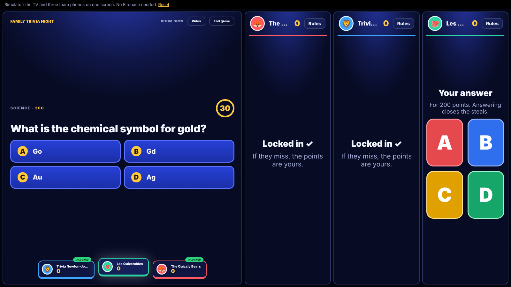
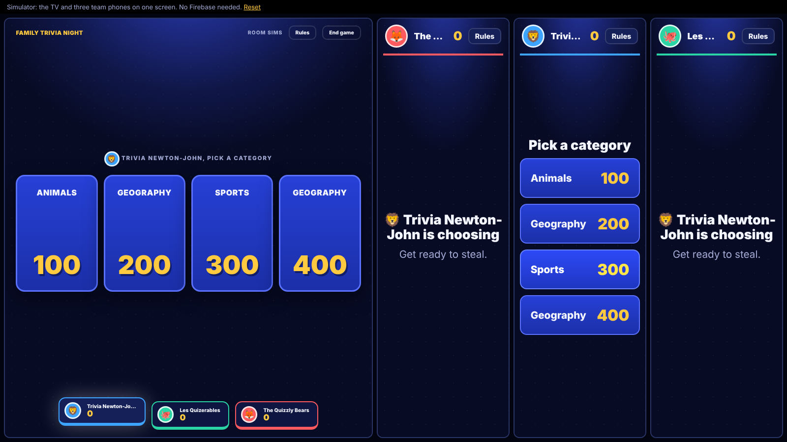

# Family Trivia Night: Party Edition

A game-show style trivia night for the living room. The TV is the board, each team's phone is its controller, and Claude writes every question, picks the final, and judges the typed answers.



## The Problem

Holiday trivia with a mixed crowd usually goes one of two ways. Someone reads questions off a phone and half the room checks out, or you buy a boxed game whose questions are ten years stale and skewed to one generation.

I wanted something that felt like a real game show: teams, a board on the TV, everyone holding a controller, and a reason to pay attention when it is not your turn. I also wanted fresh questions every time, in categories I pick, without writing any of them myself.

## What Was Built

A browser game with three pieces: a host page for the TV, a controller page for phones, and Claude behind the scenes.

- **Teams and turns.** One phone per team. The team that is up picks one of four category cards worth 100, 200, 300 or 400. The value is the difficulty.
- **Steals.** While the active team is deciding, every other team can secretly lock in its own answer. If the active team misses, correct steals earn half the points. The moment the active team answers, steals close, so answering fast is a defense.
- **A wager final.** Teams see only the category, bet points in secret, then type an answer. Claude judges the answers and forgives spelling. The reveal runs from last place to first.
- **No quizmaster.** The phones drive the game, so the person who set it up gets to play.
- **Sudden death** if teams are tied at the end.
- **Rematch or new game.** After the winner is crowned, one button starts a rematch with the same teams and phones, and another starts fresh with a new code. A game holds up to 8 teams.
- **No repeats.** The game remembers the questions and answers it has shown, across game nights, and tells Claude to stay away from them.




The full rules and every design decision are in [SPEC.md](SPEC.md).

## Where Claude Does the Work

The game makes three kinds of calls to the Claude API.

1. **Question writing.** One call per turn writes the questions for all four cards, each at its card's difficulty, while the team is still getting ready. The prompt sets a target for each value (a 100 is something about 75% of adults know, a 400 about 15%) and nudges each card toward a random decade so questions range across generations.
2. **The final question.** One call writes a hard question with a single short answer, plus the alternate answers that should also count.
3. **Judging.** One call grades every team's typed answer against the correct one. Team answers are passed as data, and the judge is told to ignore any instructions inside them. The host can overrule any ruling.

Every request also carries the game's memory: questions already shown and answers already used, with an instruction not to reuse them.

A full game for three teams is about 17 calls and costs a few cents on Claude Haiku.

## How It Works

1. The host laptop opens the host page, takes an Anthropic API key, and creates a room.
2. The TV shows a QR code and a four-letter code. Each team scans it and picks a team name and avatar.
3. The laptop is the brain. It calls Claude, keeps score and holds the answers.
4. Phones send taps ("picked card 2", "answered B") and show whatever the laptop publishes.
5. Firebase Realtime Database relays messages between the laptop and the phones. There is no server code.

A correct answer never leaves the laptop before the reveal, so nobody can peek by inspecting their phone's browser.

## Try It in Two Minutes

Open `simulator.html` in a browser. It shows the TV and three team phones on one screen and needs no accounts.

- With no API key it plays with a small built-in question bank.
- Paste an Anthropic API key on the TV's setup screen and Claude writes the questions.

## Run a Real Game

Phones need a web address and a relay. Firebase provides both on its free Spark plan, with no credit card.

1. **Create a Firebase project** at console.firebase.google.com.
2. **Create a Realtime Database** (Databases & Storage > Realtime Database) in locked mode.
3. **Turn on anonymous sign-in** (Security > Authentication > Sign-in method > Anonymous).
4. **Add a web app** (Add app > Web on the project overview). Copy `js/config.example.js` to `js/config.js` and paste the config values in.
5. **Deploy** from this folder (needs Node.js):
   ```
   npx firebase-tools login
   npx firebase-tools use --add
   npx firebase-tools deploy
   ```
6. **Play.** Open `https://your-project.web.app/tv.html` on the laptop, create a game, and have each team scan the QR code.

### Taking it offline between game nights

- `bash go-private.sh` locks the database so nothing can read or write it, then takes the website offline.
- `bash go-public.sh` publishes the game's rules and the website again.

## Security and Risk Notes

- **The API key lives in one browser tab.** It is kept in the host tab's session storage, sent only to api.anthropic.com, and gone when the tab closes. Phones never receive it and it is never written to Firebase. Use a dedicated key with a spend limit.
- **Question history stays in the host browser.** Questions and answers that have been shown are remembered in the host laptop's browser so later game nights do not repeat them. It is trivia text only, with no team names or scores, and the setup screen has a button to clear it.
- **Answers stay on the host.** Phones receive only what they are meant to display.
- **Database rules do the access control.** Every device signs in anonymously. A phone can write only its own team's entries, and only the host can read teams' secret answers and wagers.
- **Typed answers are untrusted input.** They are length-limited, rendered as text and never as HTML, and passed to the judging prompt as data.
- **Model output is untrusted too.** Questions are rendered as text, and the game shuffles answer order itself.
- **Security headers** in `firebase.json` limit the deployed site to connecting to Anthropic and Firebase.
- **Firebase config is not a secret**, but `js/config.js` is ignored by Git so project details stay out of the repo. The rules are what protect the data.
- **The site is public while it is deployed.** Anyone with the address could create rooms and use free-tier quota. They cannot reach the API key. The `go-private.sh` script closes that gap between game nights.
- **Known gap:** a room abandoned mid-game stays in the database until it is deleted in the Firebase console.

## PM Takeaways

**Decide the rules before writing any code.** The spec was settled one decision at a time: turn-based or simultaneous, what age should do, how steals pay, who runs the game. Each answer narrowed the next question. By the time the build started there was nothing left to guess, and the first version matched the spec.

**Cut what you will not miss.** Custom avatar art gave way to emoji. Collecting every player's name at signup gave way to a team name. Neither cut cost anything at the table, and both removed work and friction.

**Build the test harness before the infrastructure.** A simulator that runs the TV and three phones on one screen came before any cloud setup. The whole game was playable, and changeable, before a backend existed. When the backend arrived it only had to relay messages.

**A rule is not finished until you have seen it run.** Steals first had a grace window after the active team answered. Seeing the first build made it clear that closing steals the instant the active team answers was better, because it gives that team a defense.

**Models repeat themselves, so put the randomness in the code.** In early testing, two games in a row ended on the same final answer. Asked the same open question twice, a model tends to reach for the same favorite. The fix was not a better prompt. The game now draws the category and era itself, keeps a list of what has been asked, and bans answers it has already used.

**Put the secret where the trust is.** Players' phones are the least trusted devices in the room, so they hold nothing: no key, no answers. That one decision shaped the whole architecture.

## What's in the Folder

| File | What it is |
|---|---|
| `tv.html`, `js/tv.js` | The host page and game engine. |
| `play.html`, `js/play.js` | The phone controller. |
| `simulator.html` | TV plus three phones on one screen, for testing. |
| `js/claude.js` | The three Claude API calls and the demo question bank. |
| `js/transport.js` | Message relay: Firebase for real games, a local relay for the simulator. |
| `database.rules.json` | Firebase access rules. |
| `firebase.json` | Hosting settings and security headers. |
| `go-private.sh`, `go-public.sh` | Take the game offline and bring it back. |
| `js/vendor/` | Firebase SDK 13.4.0 (Apache 2.0) and qrcode-generator 2.0.4 (MIT), stored locally so nothing loads from a CDN. |
| `SPEC.md` | The product spec. |
